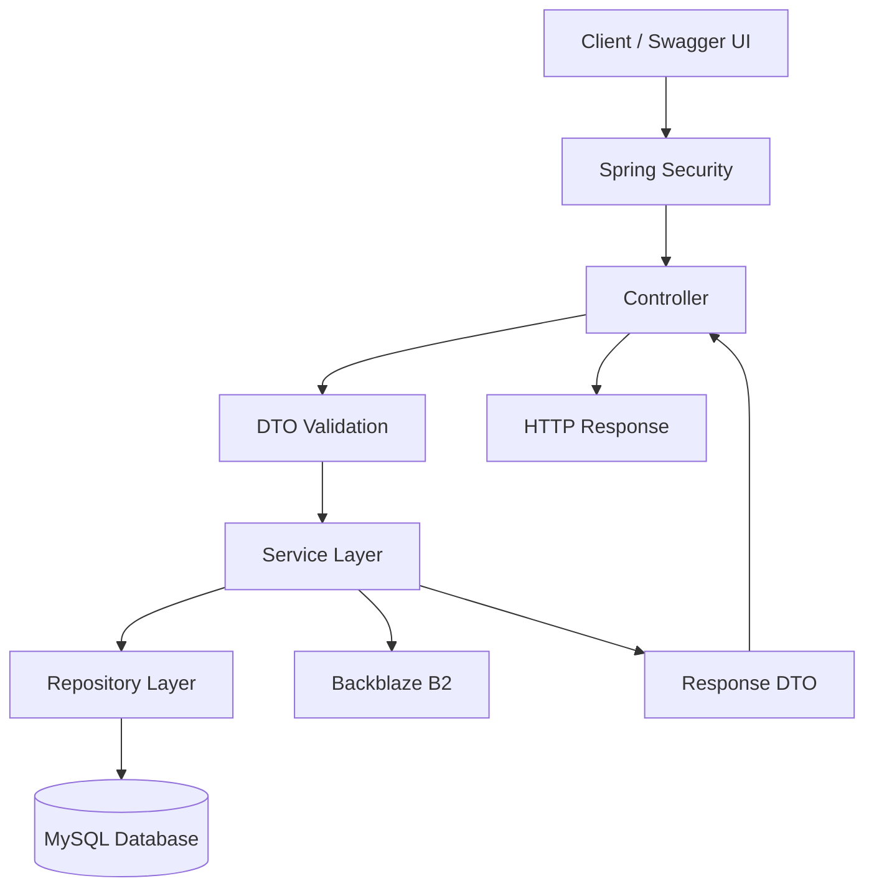
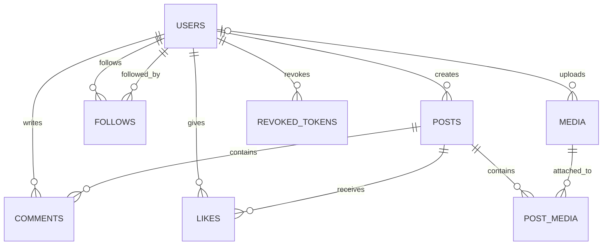
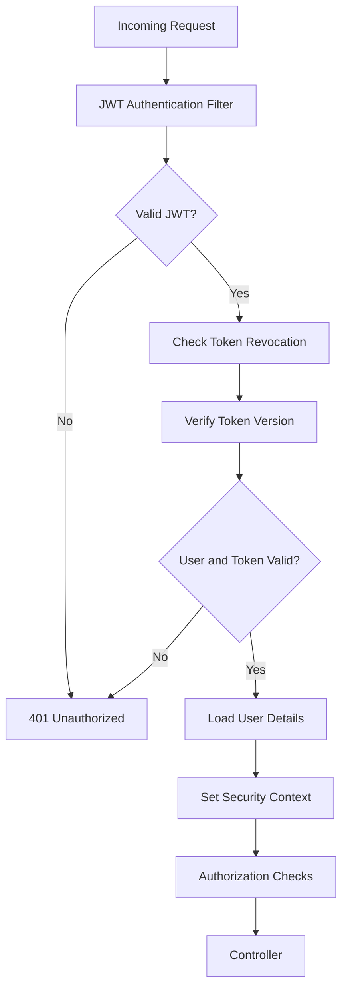
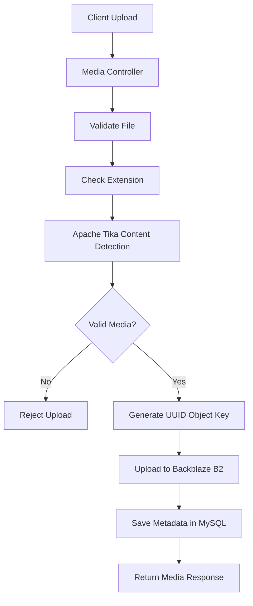
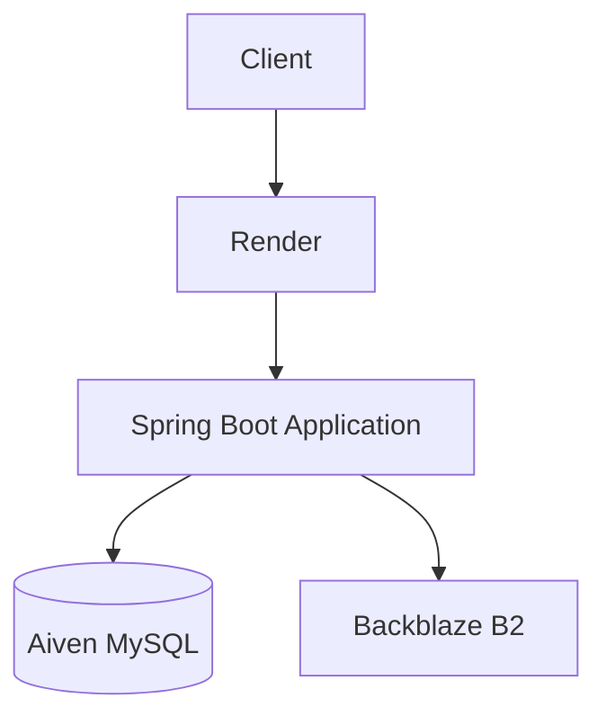

# Social Media Backend

A RESTful social media backend built using **Java 25 and Spring Boot**. The application provides user authentication, profile management, post creation, comments, likes, follow relationships, personalized feeds, and media management.

The project follows a layered architecture and uses JWT-based authentication, role-based authorization, MySQL for relational data, and Backblaze B2 for media storage.

The application is deployed on Render, with a managed MySQL database hosted on Aiven.

## Live Application

| Resource | Link |
|---|---|
| Swagger UI | [View API Documentation](https://social-media-backend-8res.onrender.com/swagger-ui/index.html) |
| GitHub Repository | [SOCIAL-MEDIA-BACKEND](https://github.com/suryaar23/SOCIAL-MEDIA-BACKEND) |

The Swagger UI provides interactive API documentation for exploring and testing the application's endpoints.

---

## Demo Credentials

Use the following demonstration accounts to explore the deployed application.

| Account | Role | Username | Password |
|---|---|---|---|
| Test User 1 | USER | user1 | Pass@123 |
| Test User 2 | USER | user2 | Pass@123 |
| Admin | ADMIN | admin | Pass@123 |

### How to Use the Demo Accounts

1. Open the [Swagger UI](https://social-media-backend-8res.onrender.com/swagger-ui/index.html).
2. Execute `POST /api/auth/login` using one of the demo accounts.
3. Copy the JWT returned by the login endpoint.
4. Click **Authorize** in Swagger UI.
5. Enter the token using the authentication format indicated by the Swagger security scheme.
6. Explore the authenticated endpoints.

**Notes:**
- Use the USER accounts to test standard social media functionality.
- Use the ADMIN account to access administrative listing endpoints.
- These are shared demonstration accounts. Avoid storing personal or sensitive information.
- Demo accounts and their associated data may be reset periodically.

---

## Features

### Authentication and User Management

- User registration and login.
- JWT-based authentication.
- Secure password hashing using BCrypt.
- Token revocation on logout.
- Password change with invalidation of previously issued tokens.
- User profile retrieval, updating, and account deletion.
- Public user profiles and username-based search.
- Role-based access control for USER and ADMIN roles.

### Post Management

- Create posts containing text, media, or both.
- Retrieve individual posts and posts belonging to a user.
- Update and delete owned posts.
- Attach multiple media items to a post.

### Social Interactions

- Add, retrieve, update, and delete comments.
- Like and unlike posts.
- Follow and unfollow users.
- Retrieve followers and following lists.
- View a personalized feed containing posts from followed users.

### Media Management

- Upload images, videos, and audio files.
- Validate file extensions and actual content types.
- Store media in Backblaze B2.
- Generate time-limited presigned URLs.
- Enforce media ownership and deletion restrictions.

### Administration

- Role-protected administrative endpoints.
- Paginated user listings.
- Paginated post listings.

---

## Technology Stack

| Category | Technologies |
|---|---|
| Programming Language | Java 25 |
| Backend Framework | Spring Boot 4.1.0 |
| Web Layer | Spring WebMVC |
| Security | Spring Security |
| Authentication | JSON Web Tokens (JWT) |
| Password Hashing | BCrypt |
| Persistence | Spring Data JPA, Hibernate |
| Database | MySQL |
| JWT Library | JJWT 0.12.6 |
| Object Storage | Backblaze B2 (S3-compatible API) |
| File Validation | Apache Tika |
| API Documentation | Springdoc OpenAPI / Swagger UI |
| Cloud SDK | AWS SDK for Java (S3) |
| Build Tool | Maven |
| Containerization | Docker |
| Deployment | Render |
| Managed Database Hosting | Aiven |

---

## Application Architecture

The application follows a layered architecture to separate request handling, business logic, data access, and external service integration.

### Layer Responsibilities

| Layer | Responsibility |
|---|---|
| Controller | Handles HTTP requests and responses |
| DTO | Defines request and response data structures |
| Service | Implements business logic and application rules |
| Repository | Performs database operations using Spring Data JPA |
| Entity | Represents persistent database entities |
| Security | Handles authentication, token validation, and authorization |
| Configuration | Configures application components and external integrations |
| Exception | Handles application exceptions and error responses |

### Request Processing Flow



The service layer coordinates business operations and interacts with the repository layer and external storage when required.

---

## Project Structure

```text
SOCIAL-MEDIA-BACKEND/
│
├── Database/
│   └── schema.sql
│
├── aiven/
│   └── aiven-ca.pem
│
├── src/
│   ├── main/
│   │   ├── java/
│   │   │   └── com/suryaar/socialmedia/
│   │   │       ├── config/
│   │   │       ├── controller/
│   │   │       ├── dto/
│   │   │       ├── entity/
│   │   │       ├── exception/
│   │   │       ├── repository/
│   │   │       ├── security/
│   │   │       ├── service/
│   │   │       └── SocialMediaBackendApplication.java
│   │   │
│   │   └── resources/
│   │       ├── application.properties
│   │       └── application-prod.properties
│   │
│   └── test/
│
├── screenshots/
│
├── .dockerignore
├── .gitignore
├── Dockerfile
├── pom.xml
├── mvnw
└── mvnw.cmd
```

---

## Database Design

The application uses MySQL with eight relational tables.

### Entity Relationship Diagram



### Table Responsibilities

| Table | Responsibility |
|---|---|
| `users` | Stores user accounts, credentials, roles, and token versions |
| `posts` | Stores posts created by users |
| `media` | Stores uploaded media metadata and storage references |
| `post_media` | Maps media items to posts and maintains attachment order |
| `comments` | Stores comments associated with posts and users |
| `likes` | Maintains user-post like relationships |
| `follows` | Maintains follower-following relationships |
| `revoked_tokens` | Stores revoked JWT identifiers until their expiration |

### Database Design Considerations

- Primary keys and foreign keys maintain relational integrity.
- Composite primary keys prevent duplicate like and follow relationships.
- The `post_media` table separates media storage metadata from post associations.
- A position field maintains the order of media attached to a post.
- Media files are stored in object storage rather than directly in MySQL.
- Hibernate schema validation checks entity mappings against the existing database structure.

---

## Authentication and Security

The application uses Spring Security with JWT-based authentication and role-based authorization.

### JWT Authentication

After successful login, the application issues a signed JWT.

The token contains:

- User ID as the subject.
- Unique token identifier (`jti`).
- Token version.
- Issued-at timestamp.
- Expiration timestamp.

**Token expiration: 15 minutes.**

### Authentication Request Flow



### Token Revocation

The application implements persistent token revocation.

- On logout, the current token's identifier is stored in the `revoked_tokens` table.
- Subsequent requests using that token are rejected.
- A scheduled cleanup task removes expired revoked-token records.
- Password changes increment the user's token version, invalidating previously issued tokens.

### Role-Based Authorization

| Role | Permissions |
|---|---|
| USER | Standard authenticated application operations |
| ADMIN | Standard operations and administrative listing endpoints |

Administrative endpoints are protected using role-based access control.

### Additional Security Measures

- BCrypt password hashing.
- Stateless Spring Security session configuration.
- Custom handling for unauthorized and forbidden requests.
- Server-side ownership checks for posts, comments, and media.
- Environment-based configuration for sensitive credentials.
- JWT revocation and token-version validation.

JWT authentication is stateless at the HTTP session level, but token validation performs database checks for revocation and current user information.

---

## REST API Reference

The application exposes RESTful endpoints organized by functionality.

Full request and response schemas are available through the deployed Swagger UI.

**Swagger UI:** [Open API Documentation](https://social-media-backend-8res.onrender.com/swagger-ui/index.html)

### Authentication

| Method | Endpoint | Access | Description |
|---|---|---|---|
| POST | `/api/auth/register` | Public | Register a new user |
| POST | `/api/auth/login` | Public | Authenticate a user |
| POST | `/api/auth/logout` | Authenticated | Revoke the current token |
| POST | `/api/auth/change-password` | Authenticated | Change account password |

### Users

| Method | Endpoint | Access | Description |
|---|---|---|---|
| GET | `/api/users/me` | Authenticated | Retrieve current user's profile |
| PATCH | `/api/users/me` | Authenticated | Update current user's profile |
| DELETE | `/api/users/me` | Authenticated | Delete current user's account |
| GET | `/api/users/{username}` | Public | Retrieve a public user profile |
| GET | `/api/users/search` | Public | Search users by username |

### Posts

| Method | Endpoint | Access | Description |
|---|---|---|---|
| POST | `/api/posts` | Authenticated | Create a post |
| GET | `/api/posts/{postId}` | Public | Retrieve a post |
| PATCH | `/api/posts/{postId}` | Authenticated | Update an owned post |
| DELETE | `/api/posts/{postId}` | Authenticated | Delete an owned post |
| GET | `/api/users/{username}/posts` | Public | Retrieve a user's posts |

### Comments

| Method | Endpoint | Access | Description |
|---|---|---|---|
| POST | `/api/posts/{postId}/comments` | Authenticated | Add a comment |
| GET | `/api/posts/{postId}/comments` | Public | Retrieve post comments |
| PATCH | `/api/posts/{postId}/comments/{commentId}` | Authenticated | Update an owned comment |
| DELETE | `/api/posts/{postId}/comments/{commentId}` | Authenticated | Delete an owned comment |

### Likes

| Method | Endpoint | Access | Description |
|---|---|---|---|
| POST | `/api/posts/{postId}/like` | Authenticated | Like a post |
| DELETE | `/api/posts/{postId}/like` | Authenticated | Unlike a post |

### Follow System

| Method | Endpoint | Access | Description |
|---|---|---|---|
| POST | `/api/users/{username}/follow` | Authenticated | Follow a user |
| DELETE | `/api/users/{username}/follow` | Authenticated | Unfollow a user |
| GET | `/api/users/{username}/followers` | Public | Retrieve followers |
| GET | `/api/users/{username}/following` | Public | Retrieve following list |

### Feed

| Method | Endpoint | Access | Description |
|---|---|---|---|
| GET | `/api/users/me/feed` | Authenticated | Retrieve personalized feed |

### Media

| Method | Endpoint | Access | Description |
|---|---|---|---|
| POST | `/api/media` | Authenticated | Upload media |
| DELETE | `/api/media/{mediaId}` | Authenticated | Delete owned media |

### Administration

| Method | Endpoint | Access | Description |
|---|---|---|---|
| GET | `/api/admin/users` | ADMIN | Retrieve paginated user listings |
| GET | `/api/admin/posts` | ADMIN | Retrieve paginated post listings |

---

## API Usage Examples

The following workflow demonstrates how to authenticate and access protected endpoints.

### 1. User Login

**Endpoint:** `POST /api/auth/login`

Send the login credentials using the request structure documented by the login endpoint in Swagger UI.

On successful authentication, the application returns a JWT.

### 2. Authorize API Requests

Use the JWT returned by the login endpoint to access protected resources.

In Swagger UI:

1. Click **Authorize**.
2. Enter the JWT in the format required by the API's security scheme.
3. Confirm authorization.
4. Execute protected endpoints.

### 3. Retrieve the Current User Profile

**Endpoint:** `GET /api/users/me`

Retrieves the profile belonging to the currently authenticated user.

### 4. Create a Post

**Endpoint:** `POST /api/posts`

Authenticated users can create posts containing text, media, or both.

Refer to the Swagger request schema for the exact request structure and media references.

### API Testing

All endpoints can be explored and tested interactively through:

[Open Swagger UI](https://social-media-backend-8res.onrender.com/swagger-ui/index.html)

---

## Business Rules and Validation

The application enforces validation rules at the request and service layers.

### User Management

- Username length must be between 5 and 10 characters.
- Usernames support letters, numbers, and underscores.
- Spaces and other special characters are not allowed.
- Email addresses must be valid.
- Email and phone number must be unique among active accounts.
- Registration passwords must contain exactly 8 characters.
- Users can update and delete their own accounts.
- Account deletion uses a soft-delete mechanism.

### Posts

- A post must contain at least text or media.
- Maximum post text length: 250 characters.
- A post can contain up to 10 media items.
- Duplicate media attachments are rejected.
- Only media uploaded by the post author can be attached.
- Combined media size per post must not exceed 100 MB.
- Media attachment order is preserved.

### Comments

- Comment text is required.
- Maximum comment length: 250 characters.
- Users can update and delete only their own comments.

### Likes

- Duplicate likes are prevented.
- Composite primary keys enforce uniqueness at the database level.
- Users can remove their likes.

### Follow System

- Users cannot follow themselves.
- Duplicate follow relationships are prevented.
- Users can follow and unfollow other users.

### Personalized Feed

- Displays posts from followed users.
- Posts are ordered newest first.
- The authenticated user's own posts are excluded.
- Results are paginated.

### User Search

- Search is based on username only.
- Matching is case-insensitive.
- Results are paginated.

---

## Pagination

Paginated endpoints allow clients to retrieve collection data in manageable batches.

The application uses page-based pagination.

### Pagination Parameters

| Parameter | Description |
|---|---|
| `page` | Zero-based page number |
| `size` | Number of records requested |

### Known Pagination Constraints

| Endpoint | Default Page | Default Size | Maximum Size |
|---|---:|---:|---:|
| User Search | 0 | 20 | 100 |
| Personalized Feed | 0 | 20 | 50 |

Other paginated endpoints may have their own defaults and validation constraints. Refer to the individual Swagger endpoint documentation for their supported parameters.

### Pagination Behavior

- The first page starts at index `0`.
- Results are returned in pages.
- Page and size parameters are validated.
- Invalid pagination values are rejected according to endpoint-specific rules.

---

## Error Handling

The application uses centralized exception handling to provide consistent error responses.

Errors may occur during request validation, authentication, authorization, resource retrieval, or business-rule execution.

### Common HTTP Error Categories

| HTTP Status | Meaning | Example |
|---|---|---|
| 400 | Bad Request | Invalid request data or validation failure |
| 401 | Unauthorized | Missing or invalid authentication token |
| 403 | Forbidden | Insufficient permissions |
| 404 | Not Found | Requested resource does not exist |
| 409 | Conflict | Operation conflicts with existing application data |
| 500 | Internal Server Error | Unexpected server-side failure |

The actual status returned depends on the exception and its configured handler.

### Error Handling Approach

- Request validation errors are handled centrally.
- Authentication failures are handled through Spring Security.
- Authorization failures return forbidden responses.
- Application-specific exceptions are handled by centralized exception handling.
- Unexpected errors are handled separately from expected application errors.

This keeps error handling organized and separates application failures from unexpected server errors.

---

## Media Storage and Management

The application uses **Backblaze B2** through its S3-compatible API for external media storage.

### Supported Media Types

| Category | Supported Formats |
|---|---|
| Images | JPG, JPEG, PNG, WEBP |
| Videos | MP4, WEBM, MOV |
| Audio | MP3, WAV, OGG |

### Upload Validation

- Maximum individual upload size: 25 MB.
- Empty files are rejected.
- File extensions are validated.
- Apache Tika detects the actual file content type.
- Detected content types are checked against the allowed extensions.

### Media Upload Workflow



### Storage Implementation

- AWS SDK for Java is used to communicate with Backblaze B2.
- UUID-based object keys reduce the possibility of filename collisions.
- MySQL stores media metadata and storage references.
- Presigned GET URLs provide temporary access to stored media.
- Presigned URLs are configured with a 30-minute validity period.
- Users can delete only their own uploaded media.
- Media attached to a post cannot be independently deleted.
- When a post is deleted, associated media is removed only when it is no longer referenced by another post.

---

## Local Setup and Installation

### Prerequisites

- Java 25 or later.
- MySQL.
- Maven or the included Maven Wrapper.
- Backblaze B2 account and bucket.

### 1. Clone the Repository

```bash
git clone https://github.com/suryaar23/SOCIAL-MEDIA-BACKEND.git

cd SOCIAL-MEDIA-BACKEND
```

### 2. Create the Database

Create the MySQL database:

```sql
CREATE DATABASE social_media;
```

Execute the SQL schema script:

```text
Database/schema.sql
```

The database schema must be initialized before starting the application because Hibernate is configured to validate the existing database structure.

### 3. Configure Environment Variables

The application reads sensitive configuration through environment variables.

| Variable | Purpose |
|---|---|
| `DB_USERNAME` | MySQL username |
| `DB_PASSWORD` | MySQL password |
| `JWT_SECRET` | JWT signing secret |
| `B2_KEY_ID` | Backblaze B2 key ID |
| `B2_APPLICATION_KEY` | Backblaze B2 application key |

Configure the required variables in your local environment before starting the application.

The application properties files reference environment variables rather than storing actual credentials in the source code.

### 4. Run the Application

On Windows:

```bash
mvnw.cmd spring-boot:run
```

On Linux/macOS:

```bash
./mvnw spring-boot:run
```

### 5. Access Swagger UI

Once the application starts:

```text
http://localhost:8080/swagger-ui/index.html
```

You can now explore and test the REST APIs.

---

## Production Deployment

The application is deployed using the following infrastructure:

| Component | Platform | Responsibility |
|---|---|---|
| Backend | Render | Hosts the Spring Boot application |
| Database | Aiven | Managed MySQL database |
| Object Storage | Backblaze B2 | Stores uploaded media |
| Containerization | Docker | Packages the application |

### Deployment Architecture



### Production Configuration

The production Spring profile is activated using:

```text
SPRING_PROFILES_ACTIVE=prod
```

Production configuration uses environment variables for database connectivity, credentials, SSL truststore configuration, JWT signing, and object storage access.

Relevant production variables include:

| Variable | Purpose |
|---|---|
| `DB_HOST` | Database host |
| `DB_PORT` | Database port |
| `DB_NAME` | Database name |
| `DB_USERNAME` | Database username |
| `DB_PASSWORD` | Database password |
| `DB_SSL_TRUSTSTORE_PASSWORD` | SSL truststore password |
| `JWT_SECRET` | JWT signing secret |
| `B2_KEY_ID` | Backblaze B2 key ID |
| `B2_APPLICATION_KEY` | Backblaze B2 application key |
| `PORT` | Application port |

### Docker

The repository includes a multi-stage Dockerfile.

- The build stage uses Maven with Eclipse Temurin 25.
- The Aiven CA certificate is imported into a Java truststore during the build.
- The runtime stage uses an Eclipse Temurin 25 JRE image.
- The packaged Spring Boot application runs inside the container.

Build the Docker image:

```bash
docker build -t social-media-backend .
```

Run the container:

```bash
docker run -p 8080:8080 social-media-backend
```

Supply the required environment variables when running the container.

---

## Testing

The project includes a test source directory and Maven test dependencies, including JUnit and Mockito.

Run the test suite using the Maven Wrapper.

**Windows:**

```bash
mvnw.cmd test
```

**Linux/macOS:**

```bash
./mvnw test
```

The deployed Swagger UI can also be used to manually exercise the API endpoints.

> Note: The Dockerfile skips tests during image packaging. Run the Maven test command separately to execute the test suite.

---

## Key Implementation Decisions

Several implementation decisions were made to improve data integrity, security, and maintainability.

### Database Integrity

- **Composite Primary Keys:** Used in the `likes` and `follows` tables to prevent duplicate relationships at the database level.
- **Post-Media Mapping:** A separate `post_media` table maintains the relationship between posts and uploaded media, including attachment order.
- **Relational Data Storage:** MySQL stores application data and media metadata, while actual media files are stored externally.

### Authentication and Security

- **JWT Token Revocation:** The unique JWT identifier (`jti`) is stored in the revoked-token table during logout.
- **Token Versioning:** A token version is maintained for each user. Incrementing it invalidates previously issued tokens.
- **BCrypt:** Passwords are hashed rather than stored as plain text.
- **Ownership Validation:** Users can modify or delete only resources they are authorized to manage.

### Media Management

- **Apache Tika:** Detects actual file content types instead of relying exclusively on file extensions.
- **UUID-Based Object Keys:** Reduces the possibility of filename collisions in object storage.
- **Presigned URLs:** Provides temporary access to media without requiring permanent public object access.
- **External Object Storage:** Keeps binary media outside the relational database.

### Account Management

- **Soft Deletion:** Account deletion uses a soft-delete mechanism, with account information anonymized according to the application's deletion logic.

These decisions help maintain data integrity, enforce access control, and separate application responsibilities.

---

## Current Limitations

The current implementation focuses on core social media backend functionality.

The following capabilities are not currently implemented:

- Refresh-token mechanism.
- Real-time notifications.
- Frontend user interface.
- Automated end-to-end API integration testing.

These are potential areas for future development.

---

## Future Enhancements

Potential improvements for future iterations include:

- Automated API integration testing.
- Rate limiting and request throttling.
- Caching frequently accessed data.
- Notifications for social interactions.
- Improved observability and application monitoring.
- CI/CD automation.

---

## Author

**A R SURYA**

BE Computer Science and Engineering Graduate

- GitHub: [@suryaar23](https://github.com/suryaar23)
- Project: [Social Media Backend](https://github.com/suryaar23/SOCIAL-MEDIA-BACKEND)

